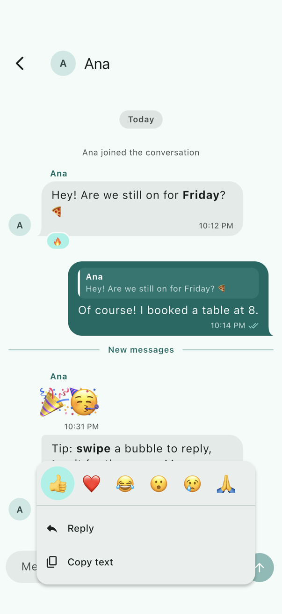
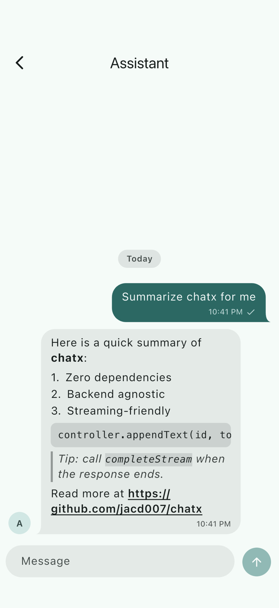
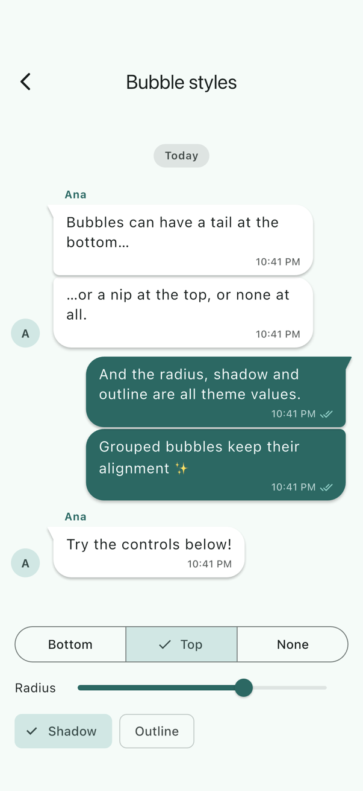

# chatx

[](https://pub.dev/packages/chatx)
[](https://github.com/jacd007/chatx/actions/workflows/ci.yml)
[](https://codecov.io/gh/jacd007/chatx)
[](LICENSE)

A complete chat UI for Flutter that works with **any backend** and has
**zero dependencies**.

You bring the messages (from Firebase, Supabase, WebSockets, REST, a local
database or an LLM). chatx renders a polished, accessible conversation that
follows your app's theme.

| Conversation | Popup menu | Swipe to reply |
| :---: | :---: | :---: |
|  |  |  |
| **AI answers** | **Bubble styles** | **Dark mode** |
|  |  |  |

## Features

- **Drop-in screen.** `ChatView` gives you a message list and input bar.
- **Any backend.** A plain `ChatController` holds the state. No streams or
  state-management package required.
- **Markdown.** Bold, italic, strike, code, code blocks, quotes, lists,
  headings and links.
- **Streaming.** Show LLM answers token by token. Only the streaming bubble
  rebuilds.
- **Replies.** Swipe a bubble to reply. Quotes jump to the original message.
- **Reactions, editing and deleting** from a menu that opens as a bottom
  sheet or as a popup, on long press or on tap.
- **Delivery status.** Sending, sent, delivered, read and failed, with retry.
- **Bubbles with character.** Tail at the bottom (iMessage style), nip at the
  top (WhatsApp style) or none, plus radius, shadow and outline.
- **Conversation UX.** Typing indicator, day separators, author grouping,
  avatars, "new messages" separator, large emoji-only messages, infinite
  history and a scroll-to-bottom button with unread count.
- **Your design.** Derived from Material 3 with automatic dark mode. Override
  any color or style, or replace any piece with a builder.
- **Accessible.** Screen reader labels, 48dp touch targets, text scaling and
  reduced-motion support.
- **Safe by default.** HTML is never interpreted and only `http`, `https` and
  `mailto` links are tappable.
- **Everywhere.** Android, iOS, web, macOS, Windows and Linux.
- **Zero dependencies.** Only the Flutter SDK.

## Contents

- [Installation](#installation)
  - [Material and `material_ui`](#material-and-material_ui)
- [Quick start](#quick-start)
- [Core concepts](#core-concepts)
- [Guides](#guides)
  - [Connect your backend](#connect-your-backend)
  - [Delivery status and retry](#delivery-status-and-retry)
  - [Streaming answers (AI chats)](#streaming-answers-ai-chats)
  - [Infinite history](#infinite-history)
  - [Typing indicator](#typing-indicator)
  - [Opening links](#opening-links)
  - [Replies and swipe actions](#replies-and-swipe-actions)
  - [Message menu](#message-menu)
  - [Reactions](#reactions)
  - [Editing and deleting](#editing-and-deleting)
  - [Unread messages](#unread-messages)
  - [Custom message types](#custom-message-types)
  - [Theming](#theming)
  - [Bubble shape](#bubble-shape)
  - [Builders](#builders)
  - [Localization](#localization)
- [Markdown reference](#markdown-reference)
- [Accessibility](#accessibility)
- [Security](#security)
- [FAQ](#faq)

## Installation

```bash
flutter pub add chatx
```

Requires Flutter 3.27 or newer.

### Material and `material_ui`

Flutter 3.50 moved the Material library to the
[`material_ui`](https://pub.dev/packages/material_ui) package and deprecated
`package:flutter/material.dart`. The two libraries use separate types, so
chatx keeps using `flutter/material.dart` to work in every app today:

- **Your app imports `package:flutter/material.dart`:** nothing to do.
- **Your app uses `material_ui`:** wrap your app once with the official
  bridge, so chatx receives your theme and localizations:

  ```dart
  MaterialApp(
    builder: (context, child) => MaterialUiCompatibilityBridge(child: child!),
    // ...
  )
  ```

chatx will move to `material_ui` in a future major version, once most apps
have migrated. The bridge setup is tested in CI on every change.

## Quick start

This is a complete, runnable chat with an echo bot:

```dart
import 'package:chatx/chatx.dart';
import 'package:flutter/material.dart';

void main() => runApp(const MaterialApp(home: ChatPage()));

const me = ChatUser(id: 'me', name: 'Me');
const bot = ChatUser(id: 'bot', name: 'Echo bot');

class ChatPage extends StatefulWidget {
  const ChatPage({super.key});

  @override
  State<ChatPage> createState() => _ChatPageState();
}

class _ChatPageState extends State<ChatPage> {
  final controller = ChatController();

  @override
  void dispose() {
    controller.dispose();
    super.dispose();
  }

  void send(String text, ChatMessage? replyTo) {
    controller.insert(TextMessage(
      id: DateTime.now().microsecondsSinceEpoch.toString(),
      author: me,
      createdAt: DateTime.now(),
      text: text,
      replyToId: replyTo?.id,
    ));
    controller.insert(TextMessage(
      id: '${DateTime.now().microsecondsSinceEpoch}-reply',
      author: bot,
      createdAt: DateTime.now(),
      text: 'You said: **$text**',
    ));
  }

  @override
  Widget build(BuildContext context) {
    return Scaffold(
      appBar: AppBar(title: const Text('Echo bot')),
      body: ChatView(
        controller: controller,
        currentUser: me,
        onSendMessage: send,
      ),
    );
  }
}
```

Place `ChatView` inside a `Scaffold` (or any widget with a bounded height) so
the input bar moves above the keyboard.

## Core concepts

### Users

```dart
const ana = ChatUser(
  id: 'user-42',                         // required, stable and unique
  name: 'Ana Ruiz',                      // optional, shown above her messages
  avatarUrl: 'https://example.com/a.png' // optional, falls back to initials
);
```

`ChatView.currentUser` decides which messages are outgoing (right side).

### Messages

`ChatMessage` is a sealed class with three kinds:

| Type | Use it for |
| --- | --- |
| `TextMessage` | Text with markdown. Supports streaming and an "edited" label. |
| `SystemMessage` | Centered notices like "Ana joined the chat". |
| `CustomMessage` | Anything else: images, polls, locations… Rendered by your builder. |

Every message has an `id`, an `author`, a `createdAt` date, and optionally a
`status`, a `replyToId`, `reactions` and `metadata` for your own data.

### The controller

`ChatController` stores messages sorted by `createdAt`. You change it, and
the view updates.

| Method | What it does |
| --- | --- |
| `insert(message)` | Adds a message. Throws if the ID exists. |
| `insertAll(messages)` | Adds many messages with one rebuild. |
| `upsert(message)` | Inserts, or replaces the message with the same ID. |
| `update(message)` | Replaces the message with the same ID. |
| `updateStatus(id, status)` | Changes the delivery status. |
| `appendText(id, delta)` | Appends streamed text. |
| `completeStream(id)` | Marks a streamed message as finished. |
| `remove(id)` | Deletes a message. |
| `setMessages(messages)` | Replaces everything, for example when switching chats. |
| `editText(id, text)` | Replaces the text and shows the "edited" label. |
| `toggleReaction(id, emoji, userId)` | Adds or removes a user's reaction. |
| `setTyping(user, isTyping: true)` | Shows or hides the typing indicator. |
| `startReply(message)` / `cancelReply()` | Shows or hides the reply banner. |
| `startEditing(message)` / `cancelEditing()` | Starts or stops editing in the input bar. |

Always call `controller.dispose()` when the screen goes away.

> **Performance note.** Changes to a single message (status, text, metadata)
> rebuild only that bubble. Listeners added with `addListener` run only for
> structural changes: insertions, removals and reordering. Use
> `controller.watch(id)` to follow one message.

## Guides

### Connect your backend

chatx does not know about your server. The pattern is always the same:

1. Listen to your backend and copy its messages into the controller.
2. In `onSendMessage`, show the message right away and send it to the backend.

```dart
// 1. Incoming messages (WebSocket, Firestore snapshot, SSE, ...).
subscription = api.messages(roomId).listen((dto) {
  controller.upsert(TextMessage(
    id: dto.id,
    author: ChatUser(id: dto.senderId, name: dto.senderName),
    createdAt: dto.sentAt,
    text: dto.body,
    status: MessageStatus.sent,
  ));
});

// 2. Outgoing messages.
ChatView(
  controller: controller,
  currentUser: me,
  onSendMessage: (text, replyTo) async {
    final id = uuid();
    controller.insert(TextMessage(
      id: id,
      author: me,
      createdAt: DateTime.now(),
      text: text,
      replyToId: replyTo?.id,
      status: MessageStatus.sending,
    ));
    try {
      await api.send(roomId, id: id, text: text);
      controller.updateStatus(id, MessageStatus.sent);
    } catch (_) {
      controller.updateStatus(id, MessageStatus.failed);
    }
  },
)
```

Use `upsert` for incoming messages: when the server echoes back a message you
already inserted, it is replaced instead of duplicated.

### Delivery status and retry

Set `status` on outgoing messages and update it as your backend reports
progress:

```dart
controller.updateStatus(id, MessageStatus.delivered);
controller.updateStatus(id, MessageStatus.read);
```

Messages with `MessageStatus.failed` show a retry button when you provide
`onRetry`:

```dart
ChatView(
  onRetry: (message) {
    controller.updateStatus(message.id, MessageStatus.sending);
    resend(message);
  },
  // ...
)
```

### Streaming answers (AI chats)

Insert an empty message with `isStreaming: true`. It shows animated dots, then
the text with a blinking caret as tokens arrive.

```dart
final id = uuid();
controller.insert(TextMessage(
  id: id,
  author: assistant,
  createdAt: DateTime.now(),
  text: '',
  isStreaming: true,
));

await for (final token in llm.stream(prompt)) {
  controller.appendText(id, token);
}
controller.completeStream(id);
```

Markdown is re-parsed safely on every chunk, so an unfinished code block
renders correctly while it streams.

### Infinite history

Provide `onLoadMore`. chatx calls it when the user scrolls near the oldest
message, and when the first page does not fill the screen. Insert the page and
return whether older messages remain:

```dart
ChatView(
  onLoadMore: () async {
    final page = await api.history(roomId, before: oldestCursor, limit: 30);
    controller.insertAll(page.map(toMessage));
    oldestCursor = page.isEmpty ? oldestCursor : page.last.cursor;
    return page.length == 30; // false stops further calls
  },
  // ...
)
```

If `onLoadMore` throws, chatx shows a retry button at the top and reports the
error to `FlutterError.onError` (so Crashlytics or Sentry receive it).

### Typing indicator

Show other users typing:

```dart
controller.setTyping(ana, isTyping: true);
controller.setTyping(ana, isTyping: false);
```

Report the current user typing to your backend:

```dart
ChatView(
  onTypingChanged: (isTyping) => api.sendTyping(roomId, isTyping),
  // ...
)
```

`onTypingChanged(false)` fires after 3 seconds without keystrokes and when the
message is sent.

### Opening links

chatx has no dependencies, so it does not open links itself. It gives you the
tapped `Uri`. With [`url_launcher`](https://pub.dev/packages/url_launcher):

```dart
ChatView(
  onLinkTap: (uri) => launchUrl(uri, mode: LaunchMode.externalApplication),
  // ...
)
```

Only links allowed by `linkPolicy` are tappable. To allow your own deep links:

```dart
ChatView(
  linkPolicy: const ChatLinkPolicy(
    allowedSchemes: {'https', 'mailto', 'myapp'},
  ),
  // ...
)
```

### Replies and swipe actions

Swiping a bubble toward the center starts a reply: a banner appears above the
input, and `onSendMessage` receives the message being replied to. Store its
ID in `replyToId` and the new bubble shows a quote. Tapping the quote scrolls
to the original message and highlights it.

```dart
ChatView(
  onSendMessage: (text, replyTo) => controller.insert(TextMessage(
    id: uuid(),
    author: me,
    createdAt: DateTime.now(),
    text: text,
    replyToId: replyTo?.id,
  )),
  // ...
)
```

Swipe to reply is on by default. Change what the swipe does, or turn it off:

```dart
ChatView(
  swipeAction: ChatSwipeAction(
    icon: Icons.star_outline,
    label: 'Star',
    onTriggered: (message) => star(message),
  ),
  // swipeAction: null, // disables swiping
  // ...
)
```

The bubble follows the finger with a spring, and a haptic tick marks the
point where releasing triggers the action. Screen reader users get the same
action in their actions menu.

### Message menu

A long press opens a bottom sheet by default. Open a popup anchored to the
bubble instead, and on a simple tap:

```dart
ChatView(
  messageMenuStyle: ChatMessageMenuStyle.popup,
  messageMenuTrigger: ChatMessageMenuTrigger.tap,
  // ...
)
```

The menu includes the built-in entries that apply to each message: Reply,
Copy text, Edit and Delete (the last two only for the current user's messages
and only when you provide `onEditMessage` and `onDeleteMessage`). Add, remove
or reorder entries with `messageActionsBuilder`, which receives those
defaults:

```dart
ChatView(
  messageActionsBuilder: (context, message, defaults) => [
    ...defaults,
    ChatMessageAction(
      label: 'Forward',
      icon: Icons.forward,
      onSelected: (message) => forward(message),
    ),
  ],
  // ...
)
```

Use `onMessageLongPress` to show your own UI instead.

### Reactions

Provide `onReactionSelected` to show a row of quick reactions in the menu and
make the reaction chips under bubbles tappable:

```dart
ChatView(
  onReactionSelected: (message, emoji) {
    controller.toggleReaction(message.id, emoji, me.id);
    api.react(message.id, emoji);
  },
  reactionEmojis: const ['👍', '❤️', '😂', '🎉'], // optional
  // ...
)
```

Reactions live in `ChatMessage.reactions`, so messages from your backend can
carry them:

```dart
TextMessage(
  // ...
  reactions: const [ChatReaction(emoji: '👍', userIds: ['ana', 'me'])],
)
```

### Editing and deleting

```dart
ChatView(
  onEditMessage: (message, newText) {
    controller.editText(message.id, newText);
    api.edit(message.id, newText);
  },
  onDeleteMessage: (message) {
    controller.remove(message.id);
    api.delete(message.id);
  },
  // ...
)
```

"Edit" fills the input with the message text and shows an edit banner; the
send button becomes a check mark. Edited messages show an "edited" label.

### Unread messages

Pass the ID of the oldest unread message. chatx shows a "New messages"
separator above it and scrolls there when the view opens:

```dart
ChatView(
  firstUnreadMessageId: conversation.firstUnreadId,
  // ...
)
```

Messages with only one to three emoji are shown large and without a bubble.
Turn this off with `enableJumboEmoji: false`.

### Custom message types

Use `CustomMessage` with a `type` and a `payload`, and render it with
`customMessageBuilder`. The result is placed inside a regular bubble, with
time and status.

```dart
controller.insert(CustomMessage(
  id: 'img-1',
  author: ana,
  createdAt: DateTime.now(),
  type: 'image',
  payload: 'https://example.com/photo.jpg',
));

ChatView(
  customMessageBuilder: (context, message, details) => switch (message.type) {
    'image' => ClipRRect(
        borderRadius: BorderRadius.circular(12),
        child: Image.network(message.payload! as String, width: 240),
      ),
    _ => const Text('Unsupported message'),
  },
  // ...
)
```

### Theming

With no configuration, chatx uses your app's `ColorScheme` and `TextTheme`,
including dark mode.

Override values for the whole app with a theme extension:

```dart
MaterialApp(
  theme: ThemeData(
    colorSchemeSeed: Colors.teal,
    extensions: const [
      ChatTheme(
        bubbleRadius: 12,
        outgoingBubbleColor: Color(0xFF0F766E),
      ),
    ],
  ),
)
```

Or for one chat with `ChatView.theme`. Unset values keep their defaults, and
text styles are merged (so `TextStyle(fontSize: 18)` only changes the size):

```dart
ChatView(
  theme: const ChatTheme(
    incomingTextStyle: TextStyle(fontSize: 18),
    maxBubbleWidthFactor: 0.9,
  ),
  // ...
)
```

Main `ChatTheme` values:

| Group | Values |
| --- | --- |
| Bubbles | `outgoingBubbleColor`, `incomingBubbleColor`, `bubbleRadius`, `bubbleGroupedRadius`, `bubblePadding`, `maxBubbleWidth`, `maxBubbleWidthFactor` |
| Bubble shape | `bubbleTail`, `bubbleTailWidth`, `bubbleTailHeight`, `bubbleElevation`, `bubbleShadowColor`, `outgoingBubbleBorderSide`, `incomingBubbleBorderSide` |
| Reactions and replies | `reactionChipColor`, `reactionChipSelectedColor`, `highlightColor`, `unreadSeparatorColor` |
| Text | `outgoingTextStyle`, `incomingTextStyle`, `linkStyle`, `codeTextStyle`, `timestampTextStyle`, `userNameTextStyle` |
| List | `backgroundColor`, `dateSeparatorTextStyle`, `dateSeparatorColor`, `systemMessageTextStyle`, `avatarSize`, `typingIndicatorColor` |
| Input | `inputBackgroundColor`, `inputFieldColor`, `inputTextStyle`, `inputHintStyle`, `sendButtonColor`, `sendButtonIconColor` |
| Status | `readStatusColor`, `errorColor` |
| Scroll button | `scrollButtonColor`, `scrollButtonIconColor`, `unreadBadgeColor`, `unreadBadgeTextColor` |

Inside your own builders, read the resolved values with
`ChatThemeData.of(context)`.

### Bubble shape

Bubbles draw a tail on the author's side. Choose its style in the theme:

| `bubbleTail` | Look |
| --- | --- |
| `ChatBubbleTail.bottom` (default) | Curved tail on the last bubble of a group, like iMessage. |
| `ChatBubbleTail.top` | Pointed nip on the first bubble of a group, like WhatsApp. |
| `ChatBubbleTail.none` | Rounded rectangles. |

```dart
ChatView(
  theme: ChatTheme(
    bubbleTail: ChatBubbleTail.top,
    bubbleRadius: 12,
    bubbleElevation: 1,
    incomingBubbleBorderSide: BorderSide(color: Colors.black12),
  ),
  // ...
)
```

Every bubble of a group reserves the tail space, so bubbles with and without
a tail stay aligned. The shape is also available as `ChatBubbleBorder` for
your own widgets.

### Builders

Replace any part of the UI:

| Builder | Replaces |
| --- | --- |
| `bubbleBuilder` | Message bubbles. Receives the default bubble, so you can wrap it. |
| `customMessageBuilder` | Content of `CustomMessage`s. |
| `systemMessageBuilder` | `SystemMessage`s. |
| `avatarBuilder` | Avatars. |
| `inputBuilder` | The input bar. Reuse `ChatInput` to add buttons. |
| `dateSeparatorBuilder` | Day labels. |
| `typingIndicatorBuilder` | The typing indicator. |
| `scrollToBottomBuilder` | The scroll-to-bottom button. |
| `loadMoreIndicatorBuilder` | The spinner shown while loading history. |
| `emptyStateBuilder` | The empty conversation placeholder. |

Example: add an attachment button to the input bar.

```dart
ChatView(
  inputBuilder: (context, send, textController) => ChatInput(
    onSend: send,
    controller: textController, // lets "Edit" fill the field
    leading: IconButton(
      icon: const Icon(Icons.attach_file),
      onPressed: pickFile,
    ),
  ),
  // ...
)
```

Other `ChatView` options: `showAvatars`, `showUserNames`,
`showDateSeparators`, `enableMarkdown`, `enableJumboEmoji`,
`groupingInterval`, `inputEnabled`, `onMessageTap`, `onAvatarTap` and
`scrollController`.

### Localization

chatx ships English and Spanish strings and picks them from the app locale.
Dates and times use your app's `MaterialLocalizations`, so add
`flutter_localizations` to get them in every language:

```dart
MaterialApp(
  localizationsDelegates: GlobalMaterialLocalizations.delegates,
  supportedLocales: const [Locale('en'), Locale('es')],
)
```

Change some strings:

```dart
ChatView(
  localizations: ChatLocalizations.en.copyWith(inputHint: 'Say hi'),
  // ...
)
```

Add a language by creating a full `ChatLocalizations` instance and passing it
to `ChatView.localizations`.

## Markdown reference

| You type | You get |
| --- | --- |
| `**bold**` or `__bold__` | **bold** |
| `*italic*` or `_italic_` | _italic_ |
| `~~strike~~` | ~~strike~~ |
| `` `code` `` | `code` |
| ```` ```lang ```` … ```` ``` ```` | code block, scrolls horizontally |
| `> quote` | block quote |
| `- item` or `1. item` | lists |
| `# Title` | heading (`#` to `######`) |
| `[label](https://…)` | link |
| `https://…` or `www.…` | automatic link |
| `\*` | a literal `*` |

Rules that keep chats readable: `snake_case` words stay intact, single line
breaks are kept, and `#hashtags` are not headings. Turn markdown off with
`enableMarkdown: false`; links are still detected.

Use `ChatText` to render the same markdown anywhere in your app.

## Accessibility

- Bubbles announce the author and time, and status icons have labels.
- The typing indicator is a live region.
- Interactive elements are at least 48×48 dp, except the small reaction chips
  (the same reactions are available in the message menu).
- Swipe actions are also available as screen reader custom actions.
- Layouts adapt to large text sizes.
- Animations stop when the system asks to reduce motion.
- Layouts mirror correctly in right-to-left languages.
- Widgets used in tests have stable keys: `chatx_input_field`,
  `chatx_send_button`, `chatx_scroll_to_bottom`, `chatx_bubble_<id>`,
  `chatx_quote_<id>`, `chatx_reaction_<id>_<emoji>`, `chatx_react_<emoji>`,
  `chatx_reply_banner`, `chatx_cancel_reply`, `chatx_edit_banner`,
  `chatx_cancel_edit`, `chatx_unread_separator`, `chatx_retry_<id>` and
  `chatx_load_more_retry`.

## Security

Message text usually comes from other people, so chatx treats it as untrusted:

- HTML is shown as text, never interpreted.
- Only links allowed by `ChatLinkPolicy` are tappable. `javascript:`, `file:`,
  `intent:` and other schemes stay plain text.
- chatx stores nothing and makes no network requests, except loading avatar
  images from `ChatUser.avatarUrl`.

See [SECURITY.md](SECURITY.md) to report a vulnerability.

## FAQ

**Does chatx send or store messages?** No. It only renders the state in your
`ChatController`. Persistence and networking stay in your code.

**How do I show images, voice notes or files?** Use `CustomMessage` and
`customMessageBuilder`. Your app chooses the picker, player and storage.

**Why are links not opening?** Provide `onLinkTap`. See
[Opening links](#opening-links).

**Can I use Riverpod, Bloc or Provider?** Yes. Create the `ChatController`
wherever you keep state and feed it from your providers or blocs.

## Example app

The [`example`](example) folder contains demos for every feature: basic chat
(replies, reactions, popup menu, editing), AI streaming, bubble styles,
custom look and infinite history. Its
[integration test](example/integration_test/screenshots_test.dart) walks
through the app on a device and produces the screenshots above.

```bash
cd example
flutter run
```

## Contributing

Contributions are welcome. Read [CONTRIBUTING.md](CONTRIBUTING.md) first.

## License

[MIT](LICENSE) © Jesus Castillo
